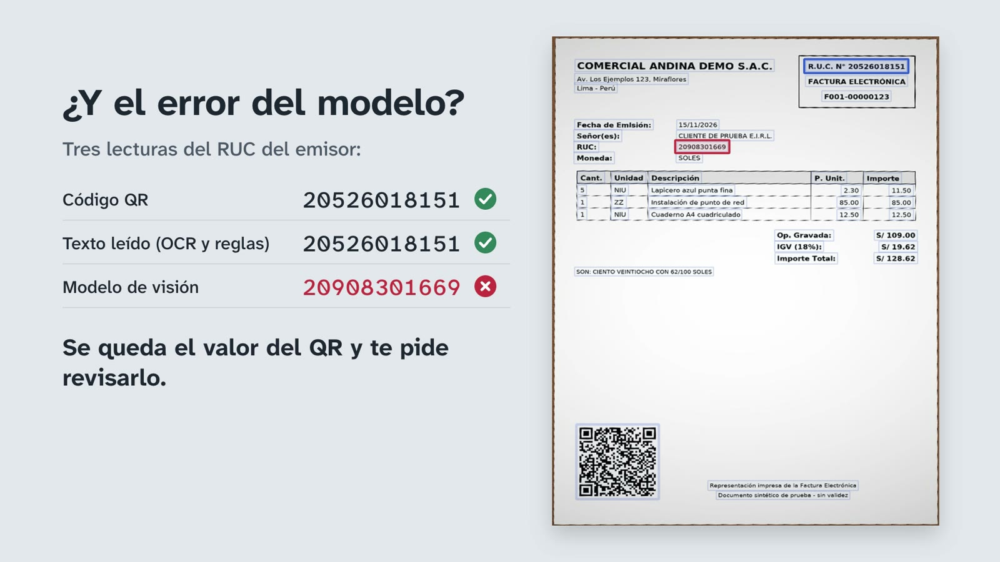
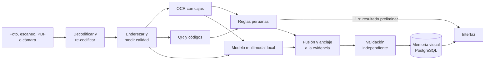
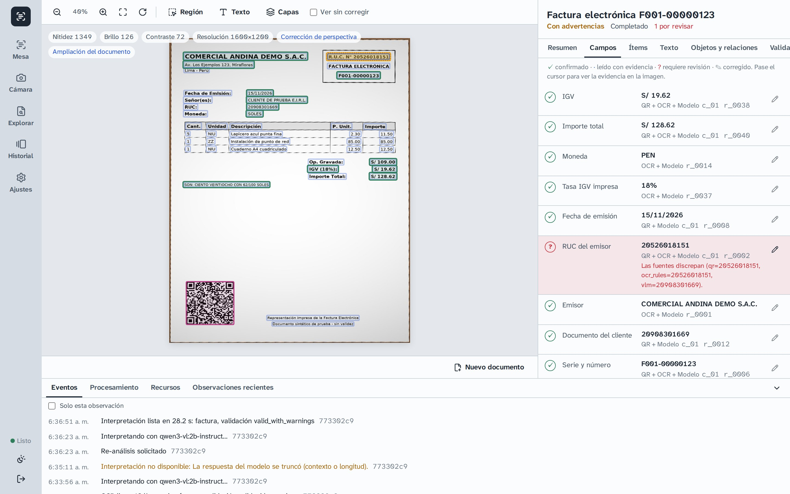
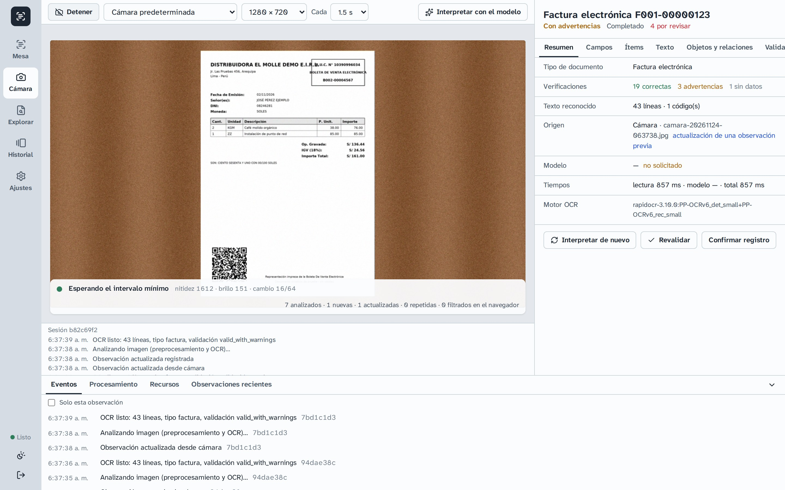
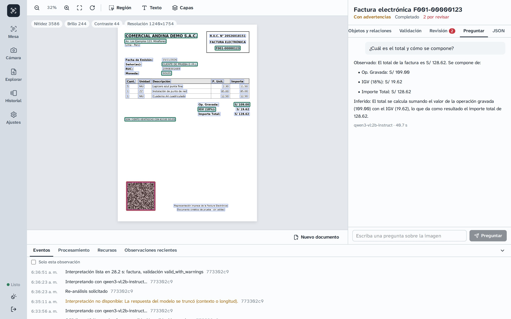
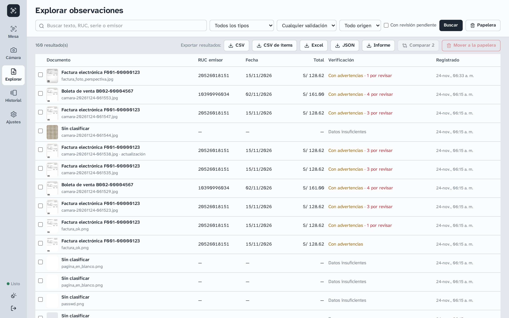

# Visual Intelligence Engine

Plataforma **local y privada** que observa imágenes, documentos y la cámara, reconoce su contenido, lo interpreta con un modelo multimodal local, extrae datos estructurados, los **verifica de forma independiente** y los guarda en una memoria visual consultable. Pensada para comprobantes peruanos (facturas, boletas, notas de crédito, RUC, IGV, PEN/USD) y con un modo universal para documentos desconocidos.

Todo corre en Docker, sin GPU y sin servicios externos: después de la instalación funciona **sin Internet**.

## Video: cómo funciona (63 s)

[](docs/media/vie-explicacion.mp4)

▶ **[Descargar el video (MP4, 1920×1080, 63 s, 16 MB, sin sonido)](docs/media/vie-explicacion.mp4)** — GitHub no reproduce en línea los MP4 guardados en el repositorio: se abre con «View raw» o «Download» y cualquier reproductor.

El video sigue **una factura real del sistema** de principio a fin: todos los números, cajas y capturas que aparecen salen de una observación procesada por el motor (`773302c9…`), incluido un error real del modelo de visión. Está hecho con [HyperFrames](https://hyperframes.heygen.com) (HTML renderizado a video); el proyecto editable está en [`video/`](video/).

## Cómo funciona, con un ejemplo

La idea central: **no se fía de una sola lectura**. Cada dato se obtiene por varias vías independientes y se guarda con su evidencia.

Tomemos la foto de una factura con perspectiva (la del video):

1. **Endereza la foto.** El motor de visión encuentra los bordes del papel, corrige la perspectiva y mide la calidad (nitidez, brillo, contraste). El original nunca se modifica; se trabaja sobre una copia re-codificada sin metadatos.
2. **Lee cada línea.** El OCR (modelos PaddleOCR PP-OCRv6 vía RapidOCR) reconoce **43 líneas en ~1 s**, cada una con su caja en la imagen (`r_0001` … `r_0043`).
3. **Decodifica el QR.** El QR de los comprobantes electrónicos trae RUC del emisor, serie, IGV, total, fecha y documento del cliente en un formato fijo.
4. **Aplica reglas.** Expresiones y validadores para RUC, fechas peruanas, montos y monedas producen una primera lectura **sin el modelo**. La interfaz ya muestra texto, cajas y validación preliminar en ~1 s.
5. **Interpreta con el modelo local.** `qwen3-vl:2b-instruct` (Ollama) recibe la imagen y el texto OCR (delimitado como datos no confiables) y devuelve JSON forzado por un esquema: tipo, descripción, campos, ítems, lo ilegible y lo inferido.
6. **Fusiona con prioridades.** QR > reglas validadas > modelo. Cada valor del modelo se busca en las regiones OCR; si no aparece, queda marcado para revisión.
7. **Verifica sin el modelo.** En esta factura: `109.00 + 19.62 = 128.62`, IGV 18 % coherente, RUC con dígito verificador correcto (módulo 11), montos del QR iguales a los impresos, importe en letras, duplicados… **28 comprobaciones: 25 correctas y 3 advertencias**.
8. **Detecta el error del modelo.** El modelo puso el RUC del cliente (`20908301669`) como RUC del emisor. QR y OCR coinciden en `20526018151`, así que se guarda ese valor y el campo queda marcado para revisión humana:

```json
"issuer_ruc": {
  "value": "20526018151",
  "source": "qr",
  "provenance": "observed",
  "sources": [
    { "source": "qr",        "value": "20526018151", "evidence_ids": [] },
    { "source": "ocr_rules", "value": "20526018151", "evidence_ids": ["r_0002"],
      "raw": "COMERCIAL ANDINA DEMO S.A.C. R.U.C. N° 20526018151" },
    { "source": "vlm",       "value": "20908301669", "evidence_ids": [] }
  ],
  "evidence_ids": ["c_01", "r_0002"],
  "bounding_box": [728, 72, 1012, 98],
  "needs_review": true,
  "review_reasons": ["Las fuentes discrepan (qr=20526018151, ocr_rules=20526018151, vlm=20908301669)."],
  "edited_by_human": false
}
```

9. **Recuerda.** Todo queda en PostgreSQL: se puede buscar, comparar, corregir (con revisiones auditadas), preguntar sobre la imagen y exportar.



## Qué hace

- Lee fotos, escaneos, capturas de pantalla, PDF (con texto incrustado o escaneados) y video (escenas clave).
- Corrige perspectiva, inclinación e iluminación; mide la calidad de la imagen; conserva siempre el original.
- Reconoce texto (OCR PaddleOCR PP-OCRv6 vía RapidOCR), QR y códigos de barras, incluido el QR SUNAT.
- Interpreta la imagen con `qwen3-vl:2b-instruct` (Ollama): tipo de documento, descripción, campos, ítems, objetos y lo que no es legible; separa lo observado de lo inferido y deja `null` lo que no puede leer. Si la respuesta se trunca, reintenta una vez con un esquema compacto.
- Extrae campos con esquemas peruanos o en modo universal, cada uno con su evidencia (región OCR o QR) y su procedencia.
- Verifica sin el modelo: sumas, subtotales, IGV según la tasa observada, RUC (módulo 11), fechas, duplicados, coherencia QR/OCR/modelo e intentos de inyección de instrucciones.
- Guarda todo, permite buscar, comparar, corregir, preguntar sobre la imagen y exportar a JSON, CSV, Excel o informe HTML.
- Modo cámara: captura con permiso explícito del navegador, detecta escenas nuevas, actualizadas o repetidas y no re-analiza lo idéntico.

## La interfaz

| Campos con su evidencia | Cámara en tiempo real |
|---|---|
|  |  |
| **Preguntar sobre la imagen** | **Explorar lo guardado** |
|  |  |

Capturas reales tomadas con Playwright del sistema en marcha (documentos sintéticos).

## Arquitectura

| Servicio | Papel | Red |
|---|---|---|
| `frontend` | nginx sin root: interfaz React + proxy de `/api`, SSE y WebSocket | única puerta: `127.0.0.1:8765` |
| `api` | FastAPI: cargas, consultas, edición, chat, exportación, acciones, cámara, sesión | interna |
| `worker` | pipeline: visión → reglas → modelo → fusión → validación → base de datos | interna |
| `vision` | decodifica archivos no confiables, preprocesa, OCR, QR, PDF y video | interna, sin acceso a la base de datos |
| `ollama` | modelo multimodal local (`qwen3-vl:2b-instruct`, CPU) | interna, sin acceso a la base de datos |
| `postgres` | memoria visual, búsqueda en español y cola de trabajos (`SKIP LOCKED` + `LISTEN/NOTIFY`) | interna |

Las redes internas no tienen salida a Internet. Detalle, diagramas y decisiones en [docs/architecture.md](docs/architecture.md) y [docs/adr/](docs/adr/).

## Requisitos

- Docker Desktop (o Docker Engine) con Compose v2. Probado en macOS (Apple M4 Pro, contenedores linux/arm64).
- Perfil lite: unos **5 GB de RAM libres en la VM de Docker** y ~12 GB de disco.
- No necesita GPU. El override `docker-compose.gpu.yml` está disponible para NVIDIA, pero no se ha verificado.

## Instalación (una vez, con Internet)

```bash
git clone https://github.com/EdilsonDeveloper135/visual-intelligence-engine.git
```

```bash
cd visual-intelligence-engine
```

```bash
make install
```

Esto comprueba el entorno, crea `.env` con secretos aleatorios (nunca se versiona), construye las imágenes con dependencias fijadas, descarga el modelo multimodal (~1,9 GB) y genera documentos sintéticos de ejemplo en `examples/generated/`.

## Uso diario (sin Internet)

```bash
make up
```

Abra http://127.0.0.1:8765 e ingrese la clave de acceso, que está en su `.env` como `VIE_ACCESS_KEY`. El puerto se cambia con `VIE_PORT`.

```bash
make down
```

`make down` detiene el sistema sin borrar datos.

## Comandos

| Comando | Para qué |
|---|---|
| `make status` | Estado y consumo de cada servicio |
| `make logs S=worker` | Ver registros de un servicio |
| `make test-unit` | Pruebas unitarias (backend, visión, frontend) en contenedores sin red |
| `make test-system` / `make test-system-all` | Pruebas contra el sistema en marcha (la segunda incluye el modelo) |
| `make test-e2e` | Pruebas en navegador con cámara simulada |
| `make test-recovery` / `make test-persistence` | Recuperación ante fallos y persistencia tras reinicio |
| `make verify-isolation` / `make verify-offline` | Endurecimiento de contenedores y ausencia de Internet en ejecución |
| `make backup` / `make restore BACKUP=…` | Respaldo y restauración |
| `make pull-model MODEL=…` | Descargar otro modelo (fase de instalación) |

## Pruebas

Resultados reales de este equipo (detalle, mediciones y lo que no se repitió tras cada cambio en [docs/test-report.md](docs/test-report.md)):

| Conjunto | Resultado |
|---|---|
| Unitarias (backend 59, visión 14, frontend 5) | 78 / 78 |
| Sistema contra el stack real, incluidas las 3 con el modelo | 29 / 29 |
| Extremo a extremo en navegador con cámara simulada | 4 / 4 |
| Aislamiento y endurecimiento de contenedores | 48 / 48 |
| Sin Internet en ejecución + pipeline completo offline | 16 / 16 |
| Recuperación ante fallos | 4 / 4 |
| Persistencia tras reinicio, respaldo y restauración | correctas |

## Seguridad y privacidad

- Las imágenes y los datos nunca salen del equipo: los servicios internos no tienen salida a Internet, la telemetría está desactivada y la interfaz solo escucha en `127.0.0.1`.
- Contenedores sin privilegios, sin capacidades, con raíz de solo lectura, usuario no root, límites de memoria y procesos, y sin `docker.sock`.
- Sesión en el servidor con cookie `HttpOnly; SameSite=Strict`, comprobación exacta de `Origin` y `Host`, CSP sin orígenes externos.
- Archivos validados por su contenido real (magic bytes), decodificados solo en el servicio de visión y servidos como copias re-codificadas.
- El modelo no tiene herramientas ni acceso a terminal, archivos o Docker; sus valores nunca disparan acciones, y el texto del documento se le entrega como datos no confiables. Las acciones están en una lista blanca.
- Borrado en dos pasos con papelera, auditoría de cada cambio.

Detalle en [docs/security-report.md](docs/security-report.md). Los documentos de ejemplo son sintéticos y ficticios.

## Limitaciones principales

- Modelo de 2B en CPU: ~30–60 s por imagen y errores de lectura reales (como el del video). Por eso el QR y las reglas tienen prioridad y las discrepancias se marcan para revisión.
- La precisión del OCR se midió con documentos sintéticos; con fotos reales, papel térmico o escritura a mano no está medida.
- HEIC no se acepta (exporte como JPEG). Un solo usuario local.

Lista completa en [docs/limitations.md](docs/limitations.md).

## El video

El proyecto [`video/`](video/) es una composición de HyperFrames: [`SPEC.md`](video/SPEC.md) (guion plano a plano), [`STORYLINES.md`](video/STORYLINES.md) (las tres historias consideradas), [`REVIEW.md`](video/REVIEW.md) (revisión) y `compositions/` (una escena por archivo). Los datos salen de [`video/capture/`](video/capture/): `data.py` exporta la observación desde la API y `capture.mjs` toma las capturas reales con Playwright.

Para volver a renderizarlo (requiere Node.js 22+ y FFmpeg en la máquina que renderiza):

```bash
cd video && npx --yes hyperframes@0.9.88 render --quality delivery -o ../docs/media/vie-explicacion.mp4
```

El video no tiene sonido a propósito (GitHub reproduce sin sonido y no se usó música de terceros). Para añadir música, coloque un archivo en `video/assets/` y agregue en `video/index.html`, dentro de `#root`, un `<audio id="musica" src="assets/su-musica.mp3" data-start="0" data-volume="0.5"></audio>`.

## Documentación

- [Manual de usuario](docs/user-manual.md)
- [Arquitectura](docs/architecture.md) y [decisiones (ADR)](docs/adr/)
- [Investigación técnica y spikes](docs/research.md)
- [API](docs/api.md) (documentación interactiva local en http://127.0.0.1:8765/docs/)
- [Operación y mantenimiento](docs/operations.md)
- [Respaldo y restauración](docs/backup-restore.md)
- [Informe de seguridad](docs/security-report.md)
- [Informe de pruebas](docs/test-report.md)
- [Limitaciones conocidas](docs/limitations.md)

## Licencias de terceros

Qwen3-VL (Apache-2.0), Ollama (MIT), RapidOCR (Apache-2.0) con modelos PaddleOCR (Apache-2.0), onnxruntime (MIT), OpenCV (Apache-2.0), zxing-cpp (Apache-2.0), pypdfium2 (Apache-2.0/BSD-3), FastAPI (MIT), PostgreSQL (PostgreSQL License), React (MIT), fuentes Atkinson Hyperlegible (OFL-1.1), GSAP (licencia estándar de GreenSock, usada solo en el video). Detalle en [docs/research.md](docs/research.md).
