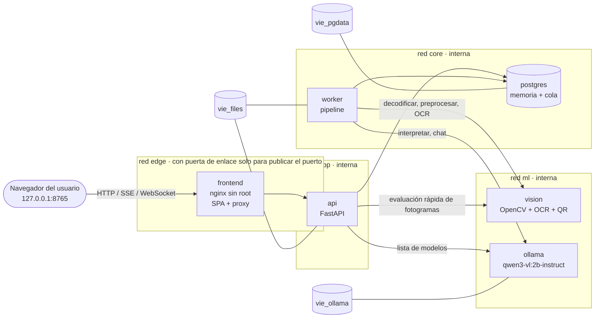
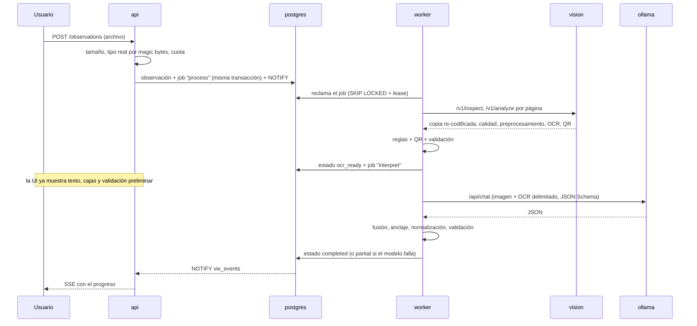

# Arquitectura

El Visual Intelligence Engine (VIE) convierte imágenes, documentos y escenas de cámara en datos estructurados verificados, sin salir del equipo. Todo corre en Docker; solo la interfaz web se publica, y únicamente en `127.0.0.1`.

## Diagrama de servicios y redes

- `vision` y `ollama` no comparten red con `postgres`: si un archivo malicioso comprometiera el decodificador, o si el modelo se comportara de forma inesperada, no tendrían acceso a los datos.
- Las redes `app`, `core` y `ml` son `internal: true` (sin salida a Internet). `edge` solo la usa nginx para poder publicar `127.0.0.1:8765`.
- Fase de instalación: el servicio `model-init` (perfil `setup`) usa una red con Internet para descargar el modelo al volumen y luego termina.

## Capas funcionales

| Capa | Dónde | Qué hace |
|---|---|---|
| A · Adquisición | `frontend` (carga de archivos, cámara con `getUserMedia`), `api` (recepción, WebSocket de cámara) | Imágenes PNG/JPEG/WEBP, PDF, capturas de pantalla, cámara del navegador. Video y secuencias: ver limitaciones. |
| B · Preprocesamiento | `vision/preprocess.py`, `vision/quality.py` | Detección y recorte del documento, corrección de perspectiva, enderezado, normalización de iluminación, CLAHE, reducción de ruido; medición de nitidez, brillo, contraste, ruido y resolución. El original nunca se modifica. |
| C · Percepción | `vision/ocr.py`, `vision/codes.py`, `vision/media.py` | OCR (RapidOCR + modelos PaddleOCR PP-OCRv6), QR y códigos de barras (zxing-cpp), capa de texto de PDF (pypdfium2), orden de lectura. |
| D · Interpretación semántica | `backend/vie/inference/` + `ollama` | Qwen3-VL 2B con salida restringida por JSON Schema: tipo, descripción, campos, ítems, objetos, elementos ilegibles, inferencias separadas de lo observado. Chat sobre la imagen. |
| E · Extracción dinámica | `backend/vie/extraction/`, `backend/vie/doc_schemas/` | Reglas peruanas (RUC, serie, montos, ítems), QR SUNAT, fusión de fuentes (QR > reglas > modelo), anclaje de cada valor a una región OCR, normalización de fechas y monedas, modo universal con campos dinámicos, esquemas personalizados. |
| F · Validación | `backend/vie/validation/` | Reglas deterministas independientes del modelo: aritmética, IGV por tasa observada, RUC módulo 11, fechas, coherencia de fuentes, duplicados, detección de inyección de instrucciones. |
| G · Memoria visual | PostgreSQL + volumen `vie_files` | Originales inmutables por SHA-256, copias procesadas, texto, coordenadas, resultados, validaciones, revisiones humanas, chat, eventos, auditoría. Búsqueda de texto completo en español. |
| H · Acciones controladas | `backend/vie/actions/registry.py`, `backend/vie/exports/` | Lista blanca de 9 acciones con parámetros estrictos; exportación JSON/CSV/XLSX/HTML. El modelo no puede invocar acciones. |

## Flujo de una observación

## Decisiones de diseño principales

Ver `docs/adr/`. Resumen:

1. **OCR con RapidOCR + modelos de PaddleOCR** en lugar de PaddlePaddle nativo (sin wheels linux/aarch64 en PyPI, bugs abiertos en arm64).
2. **PostgreSQL como base de datos y como cola** (`FOR UPDATE SKIP LOCKED` + leases + `LISTEN/NOTIFY`) en lugar de Redis: un servicio menos en una VM de 7,75 GB y estado de job y observación en la misma transacción.
3. **Consolidación de servicios**: `vision` agrupa vision-engine y ocr-engine; `worker` es la misma imagen que `api`; `inference` y `validation` son bibliotecas en proceso. La validación sigue siendo independiente del modelo por diseño (no consume su opinión), no por contenedor.
4. **Perfil lite** con `qwen3-vl:2b-instruct` dentro de 3,25 GB; perfil advanced documentado para equipos con más RAM.
5. **Dos etapas**: el usuario ve el OCR en ~1–2 s; el modelo completa la interpretación en ~30–60 s en CPU.

## Mapa del repositorio

| Ruta | Contenido |
|---|---|
| `docker-compose.yml` | Stack lite (frontend, api, worker, vision, ollama, postgres, migrate, model-init) |
| `docker-compose.test.yml` | Ejecutores de pruebas de sistema y E2E |
| `docker-compose.advanced.yml`, `docker-compose.gpu.yml` | Overrides opcionales (más RAM / GPU NVIDIA) |
| `frontend/` | React 19 + TypeScript + Vite + Tailwind; `nginx.conf` |
| `backend/vie/` | API, worker, pipeline, extracción, validación, memoria, acciones, exportación |
| `services/vision/` | Motor de visión y OCR |
| `services/ollama/` | Imagen derivada no-root y scripts de instalación de modelos |
| `configs/tax_rates.yaml` | Tasas de impuestos aceptadas por el validador |
| `scripts/` | Instalación, arranque, respaldo, verificaciones y pruebas operativas |
| `tests/` | Generador sintético, pruebas de sistema, E2E, spikes |
| `docs/` | Esta documentación |

La estructura sugerida tenía `services/ocr`, `services/inference`, `services/validation`, `workers/`, `schemas/` y `infrastructure/`. Se adaptó así: el OCR vive en `services/vision`; la inferencia, la validación, el worker y los esquemas son módulos de `backend/vie/` (`inference/`, `validation/`, `worker/`, `doc_schemas/`) porque se ejecutan en el mismo proceso; la infraestructura está en los `Dockerfile`, `docker-compose*.yml` y `frontend/nginx.conf`.
